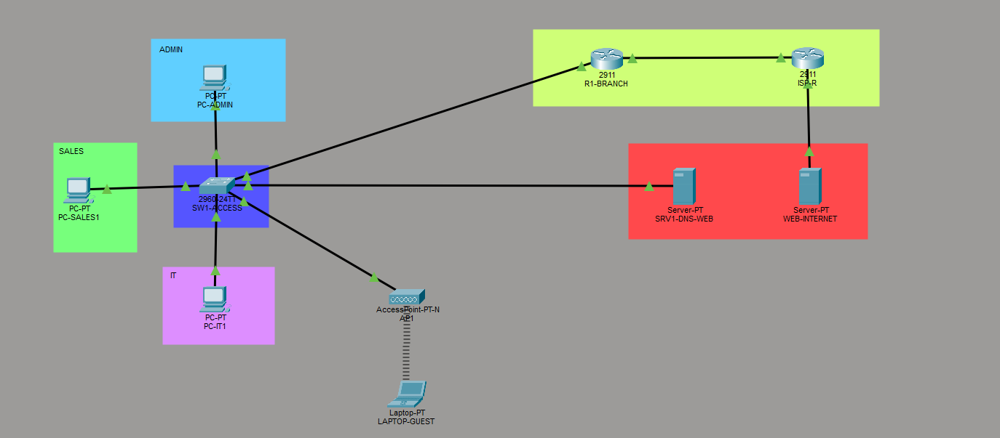

# TN-LAB Office Network — Small Enterprise Network Design (Cisco Packet Tracer)


A small office network built from scratch in Cisco Packet Tracer: **4 VLANs**, **inter‑VLAN routing**, **DHCP**, **internal DNS/HTTP**, **NAT/PAT** for internet access, an **extended ACL** isolating guest Wi‑Fi, and **WPA2** wireless.

The goal was to design, document and verify a network the way it would be done on a real site — IP plan first, then implementation, then a test plan with evidence — rather than following a tutorial.

---

## Topology



```
        +----------------------+
        |      R1-BRANCH       |  router-on-a-stick
        |      Cisco 2911      |  5 subinterfaces
        +----+------------+----+
  802.1Q trunk |            | 200.1.1.0/30
        +------+-----+   +--+-------------+
        | SW1-ACCESS |   |     ISP-R      |--- 8.8.8.0/24 --- WEB-Internet
        | 2960-24TT  |   |   Cisco 2911   |                     8.8.8.8
        +------+-----+   +----------------+
               |
   +-----------+------------+------------+-------------+
   |           |            |            |             |
 VLAN 10     VLAN 20      VLAN 30      VLAN 40       VLAN 99
 PC-ADMIN1   PC-SALES1    SRV1-DNS-WEB AP1 -> LAPTOP   switch mgmt
 192.168.10  192.168.20   192.168.30   192.168.40    192.168.99
```

---

## Features implemented

| # | Feature | Technology |
|---|---|---|
| 1 | Logical segmentation | 5 VLANs (Admin, Sales, Servers, Guest Wi‑Fi, Management) |
| 2 | Tagged uplink | 802.1Q trunk with an explicit allowed‑VLAN list |
| 3 | Inter‑VLAN routing | Router‑on‑a‑stick (`encapsulation dot1Q` subinterfaces) |
| 4 | Automatic addressing | 3 DHCP pools + excluded addresses for gateways and servers |
| 5 | Name resolution | Internal DNS A‑records (`www.tnlab.local`) |
| 6 | Internal web service | HTTP server in the server VLAN |
| 7 | Internet access | Static default route + NAT/PAT (`overload`) |
| 8 | Guest isolation | Extended ACL applied inbound on the guest gateway |
| 9 | Wireless | WPA2‑PSK SSID on VLAN 40 via a standalone AP |
| 10 | Hardening | `enable secret`, `service password-encryption`, banners, unused ports parked & shut down |
| 11 | Verification | 12‑case test plan with CLI evidence and screenshots |

---

## Addressing plan

### VLANs and subnets

| VLAN | Name | Subnet | Gateway (R1) | DHCP range | Purpose |
|---|---|---|---|---|---|
| 10 | ADMIN | 192.168.10.0/24 | 192.168.10.1 | .11 – .100 | Administration PCs |
| 20 | SALES | 192.168.20.0/24 | 192.168.20.1 | .11 – .100 | Sales PCs |
| 30 | SERVERS | 192.168.30.0/24 | 192.168.30.1 | static | DNS + web server |
| 40 | GUEST-WIFI | 192.168.40.0/24 | 192.168.40.1 | .11 – .100 | Guest wireless |
| 99 | MGMT | 192.168.99.0/24 | 192.168.99.1 | static | Switch management |

### WAN / internet segment

| Device | Interface | Address | Notes |
|---|---|---|---|
| R1-BRANCH | g0/1 | 200.1.1.1/30 | NAT outside |
| ISP-R | g0/0 | 200.1.1.2/30 | simulated ISP |
| ISP-R | g0/1 | 8.8.8.1/24 | internet segment |
| WEB-Internet | Fa0 | 8.8.8.8/24 | simulated public host |

### Static hosts

| Device | Address | Gateway |
|---|---|---|
| SRV1-DNS-WEB | 192.168.30.10/24 | 192.168.30.1 |
| SW1-ACCESS (VLAN 99) | 192.168.99.2/24 | 192.168.99.1 |

### Port map — SW1-ACCESS

| Port | Connected to | Mode | VLAN |
|---|---|---|---|
| Fa0/2 | PC-ADMIN1 | access | 10 |
| Fa0/3 | PC-SALES1 | access | 20 |
| Fa0/4 | SRV1-DNS-WEB | access | 30 |
| Fa0/5 | AP1 | access | 40 |
| Fa0/6 | optional 2nd admin PC | access | 10 |
| Fa0/7 – 23 | unused | access | 99 (shut down) |
| Fa0/24 | R1 g0/0 | **trunk** | 10,20,30,40,99 |

---

## Key configuration excerpts

**Trunk to the router (SW1)**
```cisco
interface fa0/24
 switchport mode trunk
 switchport trunk allowed vlan 10,20,30,40,99
```

**Router‑on‑a‑stick (R1)**
```cisco
interface g0/0.10
 description ADMIN gateway
 encapsulation dot1Q 10
 ip address 192.168.10.1 255.255.255.0
! ... repeated for VLANs 20, 30, 40, 99
```

**DHCP with reserved addresses (R1)**
```cisco
ip dhcp excluded-address 192.168.10.1 192.168.10.10
ip dhcp pool ADMIN
 network 192.168.10.0 255.255.255.0
 default-router 192.168.10.1
 dns-server 192.168.30.10
```

**NAT/PAT to the internet (R1)**
```cisco
ip route 0.0.0.0 0.0.0.0 200.1.1.2
access-list 1 permit 192.168.0.0 0.0.255.255
interface g0/0.10
 ip nat inside
interface g0/1
 ip nat outside
ip nat inside source list 1 interface g0/1 overload
```

**Guest isolation ACL (R1)**
```cisco
access-list 100 remark GUEST isolation
access-list 100 deny ip 192.168.40.0 0.0.0.255 192.168.0.0 0.0.255.255
access-list 100 permit ip any any

interface g0/0.40
 ip access-group 100 in
```

---

## Test plan and results

| # | From | Test | Expected | Result |
|---|---|---|---|---|
| 1 | PC-ADMIN1 | DHCP lease | 192.168.10.11–100, gw .1, DNS .10 | ✅ |
| 2 | PC-SALES1 | DHCP lease | 192.168.20.x | ✅ |
| 3 | PC-ADMIN1 | `ping 192.168.20.11` | inter‑VLAN routing works | ✅ |
| 4 | PC-ADMIN1 | `http://www.tnlab.local` | internal page loads | ✅ |
| 5 | PC-ADMIN1 | `ping 8.8.8.8` | NAT/PAT works | ✅ |
| 6 | PC-ADMIN1 | `tracert 8.8.8.8` | hop 1 = 192.168.10.1, hop 2 = 200.1.1.2 | ✅ |
| 7 | LAPTOP-GUEST | Wi‑Fi join + DHCP | 192.168.40.x over WPA2 | ✅ |
| 8 | LAPTOP-GUEST | `ping 8.8.8.8` | replies | ✅ |
| 9 | LAPTOP-GUEST | `ping 192.168.30.10` | **blocked** by ACL 100 | ✅ |
| 10 | PC-ADMIN1 | `ping 192.168.99.2` | switch management reachable | ✅ |
| 11 | R1 | `show ip nat translations` | active PAT entries | ✅ |
| 12 | ISP-R | `ping 200.1.1.1` | WAN link up | ✅ |

Verification commands used throughout: `show vlan brief`, `show interfaces trunk`, `show ip interface brief`, `show ip route`, `show ip dhcp binding`, `show ip nat translations`, `show access-lists`.

**Notable result.** Removing ACL 100 makes a guest ping to `192.168.30.10` succeed; re‑applying it blocks it again — a controlled before/after test proving the filter is what's isolating the guest segment, not a routing accident.

---

## Repository structure

```
cisco-mini-project/
├── README.md                   ← this file
├── topology.png / topology.svg ← network diagram
├── BUILD-GUIDE.md              ← full step-by-step build (design → config → test)
├── RECOVERY-RUNBOOK.md         ← rebuild procedure with pass/fail gates
└── TN-LAB-Office.pkt           ← Packet Tracer project file (open with PT 8.x / 9.x)
```

---

## How to run

1. Install **Cisco Packet Tracer** (free with a Cisco Networking Academy account: <https://www.netacad.com/resources/lab-downloads>).
2. Clone the repository and open `TN-LAB-Office.pkt`.
3. Give the simulation ~30 seconds to converge (STP listening/learning on the trunk).
4. Verify with the test plan above — start at PC-ADMIN1 → Desktop → Command Prompt.
5. To rebuild from scratch, follow `BUILD-GUIDE.md`. If a build goes wrong, `RECOVERY-RUNBOOK.md` resets and reconfigures the devices in a tested order.

**Packet Tracer device models:** 2911 (routers) · 2960‑24TT (switch) · Server‑PT · PC‑PT · AccessPoint‑PT‑N · Laptop‑PT with the `WPC300N` wireless module.

---

## Design decisions and trade-offs

| Decision | Reason | Trade-off |
|---|---|---|
| **Router‑on‑a‑stick** instead of a Layer 3 switch | No L3 switch in the budget/device set; one trunk carries all VLANs | R1 becomes the bottleneck for heavy inter‑VLAN traffic |
| **Static 802.1Q trunk** (`switchport mode trunk`) | Deterministic, no DTP negotiation | Must configure every new switch by hand |
| **Unused ports parked in VLAN 99 and shut down** | Limits the attack surface of empty wall ports | New users need a config change before plugging in |
| **ACL inbound on the guest gateway** | Filters closest to the source, before packets are routed | ACL edits affect guests only — the scope is easy to misjudge |
| **Guest DHCP still works with the ACL** | DHCP Discover is a broadcast and doesn't match the deny line | Subtle behaviour worth knowing during troubleshooting |
| **`enable secret` + `service password-encryption`** | Basic baseline hardening; no plaintext in `show run` | Not a substitute for AAA/TACACS in a real deployment |

---

## What I learned

- **Order of operations matters.** VLANs → trunk → subinterfaces → DHCP → NAT → ACL. Almost every failure traced back to skipping ahead.
- **Verification beats assumption.** Every stage is provable with one `show` command; the failure tells you which layer is broken.
- **Wildcard masks are not subnet masks.** `access-list 1 permit 192.168.0.0 0.0.255.255` is required for NAT — a `/24` wildcard there silently breaks internet access.
- **NAT needs to be told which side is which.** `ip nat inside` goes on the **subinterfaces**, never on the parent `g0/0`.
- **A test plan is the deliverable.** Screenshots of `show ip nat translations` and a blocked ping prove the design better than any paragraph.

---

## Possible extensions

- SSH instead of Telnet (`crypto key generate rsa`, `transport input ssh`, local users)
- Port security on access ports (`maximum 1`, sticky MAC, violation shutdown)
- Trunk hardening (native VLAN change, `nonegotiate`)
- A second site with OSPF between two routers
- Redundancy with HSRP
- A Cisco ASA firewall with a DMZ in front of the public web server
- IPv6 dual‑stack on the VLAN gateways

*(The firewall/DMZ variant is deliberately **not** part of this repo — this version is the tested, working core.)*

---

## Author

**Student project — ICT / Networks**
Built in Cisco Packet Tracer as a self‑directed lab to consolidate CCNA‑level switching, routing, services and security fundamentals.

## License

MIT — free to reuse and adapt. Packet Tracer is a trademark of Cisco Systems, Inc.; this repository is an independent academic project and is not affiliated with or endorsed by Cisco.
